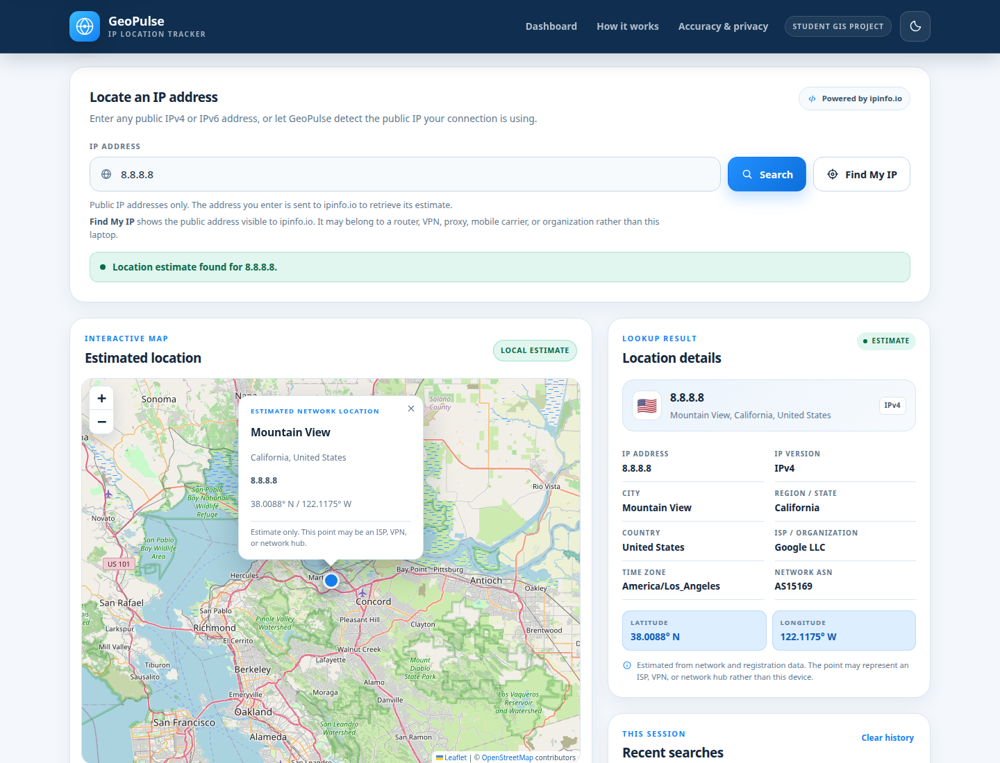

# GeoPulse — IP Location Tracker

**Design and Implementation of a Web-Based Laptop Location Tracking System Using IP Geolocation**

GeoPulse is a client-side GIS dashboard that estimates the geographic location associated with a public IPv4 or IPv6 address and plots the estimate on an interactive OpenStreetMap. It is a student project about the capabilities and limits of IP geolocation, not a GPS tracker.



## What it does

- Looks up any public IPv4 or IPv6 address through the ipinfo.io geolocation API.
- Detects the visitor's public IP with **Find My IP**.
- Shows city, region, country, coordinates, ISP/organization, network ASN, and time zone.
- Places one Leaflet marker on OpenStreetMap tiles and opens an explanatory popup.
- Keeps the last five unique successful lookups in `sessionStorage` for the current browser session.
- Provides light and dark themes, with the preference saved in `localStorage`.
- Handles invalid input, private/reserved addresses, API rate limits, network failures, malformed responses, missing coordinates, and request timeouts without inventing locations.
- Works on desktop, tablet, and mobile layouts.

## Technology

- HTML5, CSS3, and vanilla JavaScript (no framework and no build step)
- Leaflet 1.9.4 for the interactive map
- OpenStreetMap standard tiles for map data
- ipinfo.io public geolocation endpoint for IP data
- Python's `http.server` (or VS Code Live Server) for local development

No API key, account, backend, database, or paid map service is required.

## Run locally

The page must be served over HTTP rather than opened with a `file://` URL.

### Option 1: Python

From the repository root:

```bash
python3 -m http.server 8765 --bind 127.0.0.1
```

Open `http://127.0.0.1:8765/src/` in a modern browser.

### Option 2: VS Code Live Server

Open the repository folder in VS Code, then use **Open with Live Server** on `src/index.html`. The page works from either `127.0.0.1` or `localhost` because the selected API is not tied to a single development origin.

An internet connection is required for the geolocation request, Leaflet, and map tiles.

## How to use it

1. Enter a public address such as `8.8.8.8` or `2001:4860:4860::8888`.
2. Select **Search**.
3. Read the estimate in the result panel and on the map.
4. Optionally select **Find My IP** to look up the public address visible to the geolocation provider.
5. Reuse or clear recent searches from the session history panel.

A marker is an estimate for the network associated with the address. It may represent an ISP gateway, VPN exit, proxy, mobile carrier, or organization rather than the laptop in front of you.

## Data source and attribution

GeoPulse uses these keyless ipinfo.io endpoints:

- `https://ipinfo.io/json` for the visitor's public IP
- `https://ipinfo.io/<address>/json` for an explicit IPv4 or IPv6 address

The application normalizes the provider response in `src/js/app.js`: the `loc` string becomes latitude and longitude, the `org` string is split into ASN and organization name, and the ISO country code is expanded with `Intl.DisplayNames` and converted to a flag emoji. Private or reserved addresses are reported from the provider's `bogon` flag; no coordinates are fabricated.

The legacy ipinfo.io endpoint is actively maintained but IPinfo recommends its newer token-based API for new integrations. This project uses the keyless legacy endpoint so the classroom demo has no secret to configure. The provider is isolated in one small request/normalization layer, so it can be replaced later. The app handles `429` responses and other failures explicitly.

Map data and attribution:

- Map tiles: [OpenStreetMap contributors](https://www.openstreetmap.org/copyright)
- Mapping library: [Leaflet](https://leafletjs.com/)
- Geolocation data: [ipinfo.io](https://ipinfo.io/developers)

## Accuracy and privacy

- IP geolocation estimates a network's location from registration, routing, and provider data. It does not read GPS or provide continuous device tracking.
- City-level results are estimates and can be wrong. Country or region results are often more reliable than city results.
- VPNs, proxies, mobile carriers, corporate networks, and anycast services can place a marker far from the user.
- Only the five most recent successful lookups are stored, and only in the browser's `sessionStorage`. Theme is stored in `localStorage`.
- Search terms are sent over HTTPS only to ipinfo.io. There is no application backend collecting queries.
- Do not use this project for surveillance or to make claims about a person's exact location.

See [Accuracy and privacy in the research report](docs/ip-geolocation-research.md#7-accuracy-privacy-and-ethics).

## Testing

The browser suite covers happy paths, IPv4 and IPv6, Find My IP, history, themes, responsive layout, private addresses, invalid input, rate limits, network failures, timeouts, and malformed data. The final run passed **48 of 48** checks with no console errors or runtime exceptions.

See [tests/test-results.md](tests/test-results.md) for the full evidence table and screenshots.

To rerun the suite:

```bash
# Terminal 1: serve the app
python3 -m http.server 8765 --bind 127.0.0.1

# Terminal 2: start headless Chrome with the DevTools protocol
google-chrome --headless=new --no-sandbox --disable-gpu --hide-scrollbars \
  --remote-debugging-port=9222 --user-data-dir=/tmp/geopulse-chrome \
  --window-size=1440,1100 about:blank

# Terminal 3: run the checks
node tests/browser-test.js
```

Requirements: Node.js 22 or newer (the script uses the built-in `WebSocket`), Google Chrome, and a running local server. If the app is on a different port:

```bash
GEOPULSE_URL=http://127.0.0.1:5500/src/index.html node tests/browser-test.js
```

The script regenerates the files in `screenshots/` and writes `tests/latest-test-summary.json`.

## Project structure

```text
IP-Location-Tracker/
├── README.md
├── .gitignore
├── docs/
│   ├── demo-guide.md
│   └── ip-geolocation-research.md
├── screenshots/
│   ├── dashboard-dark.png
│   ├── dashboard-light.png
│   ├── error-state.png
│   ├── hero-light.png
│   └── mobile-light.png
├── src/
│   ├── index.html
│   ├── favicon.svg
│   ├── css/
│   │   └── style.css
│   └── js/
│       └── app.js
└── tests/
    ├── browser-test.js
    └── test-results.md
```

## Documentation

- [Research report](docs/ip-geolocation-research.md)
- [Demonstration guide](docs/demo-guide.md)
- [Test results](tests/test-results.md)

## Limitations and future work

- The title uses the assignment's "laptop location tracking" wording, but the implementation can only locate the public IP address it is given. It cannot find an arbitrary laptop without that address, and it cannot track movement.
- Results depend on the provider's data and are not guaranteed to be accurate or current.
- The keyless legacy endpoint is suitable for this demonstration but is not the recommended long-term integration path. A production version should use an authenticated API, a server-side proxy, caching, and an accuracy-radius field.
- A production privacy review, rate-limit strategy, and provider fallback would be required before public deployment.
